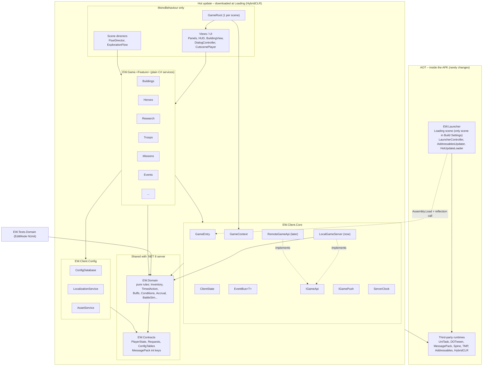
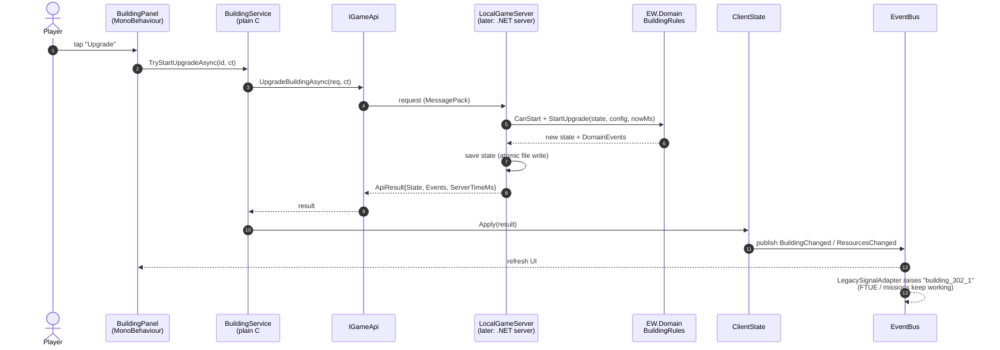
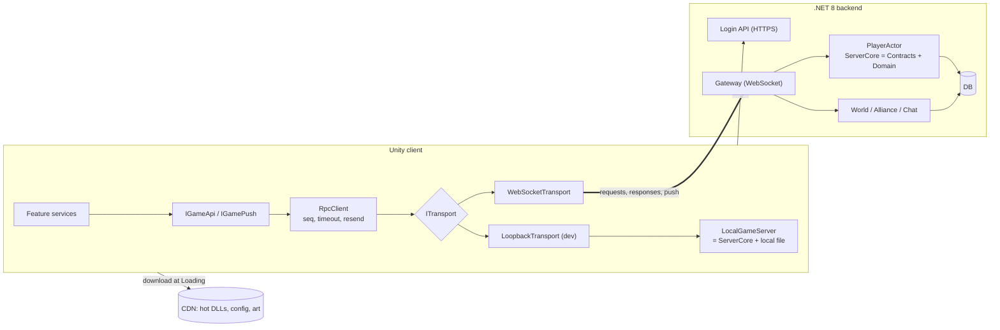
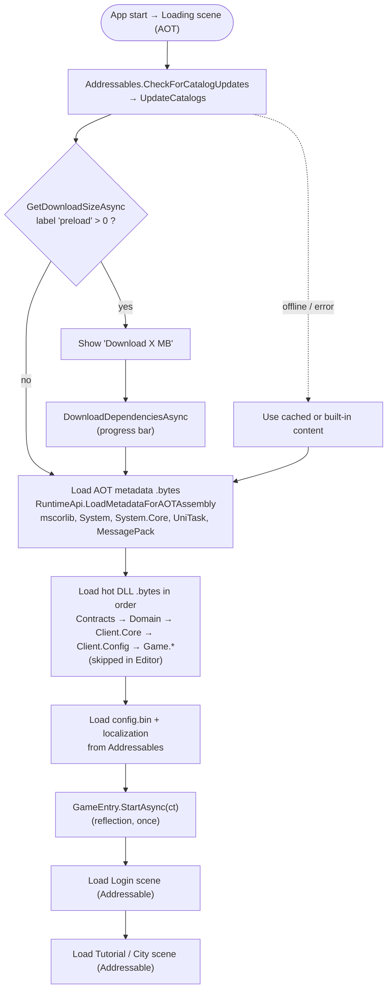
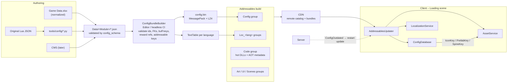

# Endless Winter – Roadmap

Where the architecture is heading and why. Rules: `.claude/rules/architecture.md`. How the project works today: `../overview.md`. API contract: `backend-api.md`.

Status (2026-10-12): A0 done; A1 server authority done (local `GameServer` owns all player state, tasks 030–041); Exploration and Heroes merged onto it. MessagePack, A2+ config and remote work still to do.

Goals:
1. Ready for a future authoritative **.NET 8 backend**.
2. **Live CMS**: operators change balance, content tables, text and art/UI without a store release.
3. **Hot update at Loading**: one download updates code (HybridCLR), config, localization, art and scenes.
4. Absorb the full design scope (99 features: 36 MVP / 30 P1 / 33 P2) without core rework.

Sources: `WOS_Phan_tich_Game_Design.docx.md`, `WOS_Dac_ta_feature_va_luong.docx.md`, `EndlessWhiteout - Feature list.csv`, `Game Data.xlsx`, `HybridCLR HotUpdate Setup Docs/`.

---

## 0. Rules, structure and current state

- The rules and the "where code goes" table are in `.claude/rules/architecture.md` (one copy per tool folder).
- How the project works today is in `../overview.md`.
- When a rule blocks you, record the exception and the reason in section 12 and add a TODO to the phase that removes it.

---

## 2. Architecture principles

1. **Plain C# by default.**
   - Plain classes with constructor injection: services, rules, state, API, config, event bus.
   - No `static Current` and no `FindAnyObjectByType`.
   - MonoBehaviour is used only for:
     - views and UI;
     - scene directors (`FtueDirector`, `ExplorationFlow`);
     - one `GameRoot` composition root per scene. It builds the plain `GameContext`, binds views through `Bind(...)`, forwards pause/quit, and drives an `ITickable` list.
2. **Server authority.**
   - Every mutation goes `UI → IGameApi.XxxAsync(req, ct) → ApiResult → ClientState.Apply → events`.
   - Random rolls and battle results are produced only behind `IGameApi`.
3. **Shared pure Domain.**
   - `EW.Domain` has no UnityEngine references and is deterministic: `nowMs` and the RNG seed are passed in.
   - The .NET 8 server compiles the same code.
4. **Data-driven.**
   - Every definition lives in a config table keyed by int id.
   - Costs, rewards, prerequisites, buffs and schedules use generic shapes.
5. **Client ↔ server connection** (see section 4b).
   - `IGameApi` for request/response, `IGamePush` for server push.
   - Both go over **one WebSocket**. HTTPS is only for login; the CDN serves downloads.
   - Until the backend exists, both run locally (`LocalGameServer`, bots).
6. **Feature modules.**
   - Each feature brings its own Domain rules, client service, views and tables.
   - It registers through `IFeatureModule.Register(GameContext)`.
   - Feature modules never reference each other; they communicate only through the event bus and Domain queries.
7. **Everything except the launcher is hot-updatable.**

---

## 3. Assembly layers

| Assembly | Layer | Contents |
|---|---|---|
| `EW.Launcher` | AOT | Loading scene, update, download, DLL loading. **Must not reference game code** |
| `EW.Contracts` | Hot, shared with server | DTOs, PlayerState, requests, config tables. `noEngineReferences`; MessagePack 2.5.x + mpc; int `[Key(n)]`, append-only |
| `EW.Domain` | Hot, shared with server | Pure rules and core services. `noEngineReferences` |
| `EW.ServerCore` | Hot, shared with server | Engine-free request handlers (section 4b). Used by `LocalGameServer` now, the .NET server later |
| `EW.Client.Core` | Hot | GameEntry, AppContext/SceneContext, ClientState, IGameApi, IGamePush, RpcClient + ITransport, ServerClock, LocalGameServer, EventBus |
| `EW.Client.Config` | Hot | ConfigDatabase, LocalizationService, AssetService |
| `EW.Game` → `EW.Game.<Feature>` | Hot | Feature services and views. Starts as a single assembly and is split in Phase A7 |
| `EW.Editor.*` | Editor | Importers, ConfigBundleBuilder, builders, hot-update build menu |
| `EW.Tests.Domain` | Editor | EditMode tests. Later also compiled into the .NET xUnit project |

---

## 4. Mutation flow (example: building upgrade)

- `LocalGameServer` completes synchronously by default and applies results optimistically, so FTUE step sequencing still works.
- An editor latency toggle exposes code that assumes instant results.
- `ServerClock` takes `ServerTimeMs` from every response; timers store absolute `EndMs`.

---

## 4a. Dependency injection: manual (decided)

No DI library. Wiring is plain code, so a missing dependency is a compile error and is easy to trace.

- **`AppContext`** lives for the whole app: Api, Push, Clock, Config, State, Bus, Assets.
- **`SceneContext`** is created per scene and disposed when the scene unloads.
- **`IFeatureModule.Register(ctx)`**: one short file per feature that does `new XxxService(...)`.
- **`GameRoot`** (the only MonoBehaviour root per scene) runs the modules, binds views, runs `ITickable`s, and forwards pause/quit.

**Injecting before Awake:**
- **Scene objects**: the scene is saved with `Content` inactive. `GameRoot.Awake` registers modules, calls `Bind(ctx)` on every `IBindable` under `Content`, then activates `Content`.
- **Prefabs**: `ctx.Instantiate(prefab, parent)` creates the clone under an always-inactive staging parent, binds it, then moves it to `parent`. That is when Awake runs.
- Addressables prefabs load with `LoadAssetAsync`, then go through `ctx.Instantiate`.

**Rules:**
- No `static` service state, no `.Current`, no `Find*` in game code.
- Services take their dependencies through the constructor.
- Views get services only in `Bind`.
- Never call raw `Instantiate` on prefabs that contain an `IBindable`.

Enforced by a grep check and an EditMode test that builds every module.

## 4b. Client ↔ server connection

- **Frames:** MessagePack frames `[opcode][seq][body]`. `OpCode` lives in `EW.Contracts`. A response reuses the request's `seq`; a push has `seq = 0`.
- **Every response carries** `Error`, `Rev`, `ServerTimeMs`, `Delta` and `Events`. A gap in `Rev` triggers a full resync.
- **Each request has a `reqId`.** The server caches the result, so a resend after reconnect never charges twice.
- **Reconnect:** `Hello{token, lastRev, versions}` → the server sends missed deltas, or answers `UpdateRequired`/`ConfigOutdated`.
- **`EW.ServerCore`** holds the engine-free request handlers. It is shared by `LocalGameServer` (dev only) and the real server, so moving to the backend means swapping the transport, not the game logic.

## 5. Hot update at Loading (HybridCLR + Addressables)

The setup follows `.docs/HybridCLR HotUpdate Setup Docs/HybridCLR HotUpdate Setup Docs.md` (the Kiếm Vương process):
- Install `https://github.com/focus-creative-games/hybridclr_unity.git` and run `HybridCLR/Installer`.
- Register the hot asmdefs in `HybridCLR/Settings`.
- Run `HybridCLR/Generate/All`, then `HybridCLR/CompileDll/<target>`.

It differs from that doc in two ways:
- The DLLs are delivered through **Addressables**, not copied by hand.
- **AOT generic metadata** is loaded as well.

**Rule**: scenes and prefabs that contain hot-update MonoBehaviours load **only after** the DLLs. The team doc has the same rule: load the DLL before loading prefab bundles.

### Addressables groups

| Group | Contents | Notes |
|---|---|---|
| `Code` | Hot DLLs and AOT metadata (`.bytes`) | Built-in copy plus remote |
| `Config` | `config.bin` and its manifest | CMS publishes here |
| `Loc_<lang>` | Text tables | One group per language |
| `Scenes_Core` | Login, Tutorial | Built-in copy plus remote |
| `Art_Core` | FTUE chapters 1–3 art | Built-in copy plus remote |
| `UI_Remote`, `Characters`, `Buildings`, `Events` | Remaining art, prefabs, Spine | Remote only |
| `Shared` | Fonts (TMP SDF), materials, Spine atlases | Avoids duplication across bundles |

### HybridCLR coding rules
- Hot MonoBehaviours and ScriptableObjects are only ever instantiated from Addressable assets, never from the built-in Loading scene.
- **Asmdef names never change.** Serialized references embed the assembly name (the team doc's `MainGame` pitfall).
- No game code stays in `Assembly-CSharp`.
- Generic instantiations of AOT generics over new value types (for example `UniTask<MyStruct>` or `Dictionary<int, MyStruct>`) rely on the metadata supplement. Review `AOTGenericReferences.cs` after `Generate/All`.
- MessagePack uses only the mpc-generated resolver, registered in a `StaticCompositeResolver`. No dynamic resolvers.
- Keep hot paths (BattleSim, ticks) allocation-free, because the interpreter is slower than AOT.

### Build pipeline (`EW/Build/Hot Update`)
1. `HybridCLR/CompileDll/ActiveBuildTarget`.
2. Copy the DLLs and AOT metadata into `Assets/_EndlessWinter/HotUpdate/*.bytes` (the `Code` group).
3. Build Addressables: a new build, or a content update using `content_state.bin` for that release.
4. Upload to the CDN.

A full app build runs `HybridCLR/Generate/All` first.

---

## 6. Core Domain services (built once)

| Service | Generic shape | Used by |
|---|---|---|
| Inventory / currencies (X04) | `ItemDef{id,type,stack}`, `ItemStack{itemId,qty}`, append-only `InventoryLog{reason,delta}`, never negative | All resources (ids 101–106 kept), speedups, shards, tokens, FC/RFC, Steel |
| Cost / Reward | `Cost[] = ItemStack[]`, `RewardGroupDef{fixed[], dropTableId}`, `DropTableDef{entries[{reward,weight}], pity}` | Build, train, missions, chapters, stages, mail, events, gacha, chests, beasts |
| TimedAction | `TimedAction{id,type,queueId,targetId,startMs,endMs,baseDurMs,buffSnapshot}`, `QueueDef{id,type,count,trial}` | Build, research, train, heal, march, pet adventure, plus speedups, Help and gem finish |
| Buff aggregator (X01) | `BuffKey` `domain.target.stat`, `BuffSource{sourceType,sourceId,key,value,expireMs}`, cached sum | Research, VIP, heroes, gear, charms, pets, experts, offices, skins |
| Gating / Unlock | `Condition{type,id,value}[]`: FurnaceLevel, BuildingLevel, StateAgeDay, ChapterDone, ResearchDone, VipLevel… | Prerequisites, feature unlocks, hero generations, pets, FC age |
| Level ladder | `LevelDef{order, label, cost[], timeSec, prereq: Condition[], power, unlocks[]}` | Furnace F1–30, 30-1…FC10, all buildings, gear, charms |
| Accrual | `Accrual{rate, cap, lastCollectMs}`, pure `Collect(now)` | Production, idle exploration (9h cap), stamina, coal burn, refills |
| Reset / Schedule | `ScheduleDef{daily UTC hh / weekday / cycleDays / stateDay, phases[]}` | Daily missions, Arena, Intel 00/08/16, events, exchange caps |
| Missions | `MissionDef{type,target,count,reward}`, progress evaluated from state and counters | Chapter missions (T03), daily/growth (T04), event tasks |
| Event framework (X03) | `EventDef{schedule,gate,phases[],scoringRules[],milestones[],rankRewards[]}`, `ActionCompleted` → scoring | Bear Hunt, SvS, Rookie event, Lucky Wheel… |
| Battle sim (X02) | `BattleInput → BattleResult + replay`, seeded | Exploration, beasts, Arena, rallies, Championship |
| Mail (T05) | `MailTemplate{type,attachments,ttl}`, idempotent claim | Rewards, reports, compensation |
| Red dots (T07) | `RedDotRule{node,parent,condition}`, computed from state | HUD |
| Commerce | `PackDef{sku,price,contents,limit,schedule}`, idempotent by `transactionId` | Packs, cards, battle pass, growth fund |

## 7. PlayerState (Contracts, append-only keys)

- **Meta**: SchemaVersion, Revision, LastSimMs, ConfigVersion, StateId, StateAgeDay.
- **Economy and city**: Inventory (sorted `ItemStack[]`), InventoryLog tail, Buildings, Queues, TimedActions, Survivors, Furnace, Accruals.
- **Progression**: Research, Troops{type,tier,count,wounded}, Heroes{id,stars,tier,shards,level,skills,gear}, Missions{id,progress,claimed}, Chapter, FtueStep, TutorialDone, DialogsSeen.
- **Monetization and events**: Mail, Purchases, Vip{level,xp,activeUntilMs}, Buffs, EventProgress, Counters (daily/weekly with resetMs).
- **Shared world state is not in PlayerState.** World map, alliance and rankings arrive through `IGamePush` and snapshot queries.
- The original game keeps the same split. Its device save holds only "seen once" flags (guide steps, popups), schedule stamps such as the snowstorm `{id, lastSetTime, targetTime}`, and settings; the server owns levels, quests and the wallet. We copy that split:
  - **Server-owned**: everything above.
  - **Local only**: `SeenFlags` and `Settings` (audio, quality, language), which never decide gameplay.

---

## 8. Config / CMS / art pipeline

**Normalizing `Game Data.xlsx`:**
- Add int ids.
- Store levels as an `order` plus a `label` (e.g. "FC 7-3").
- Convert durations to seconds.
- Turn free-text prerequisites into `Condition[]`.
- Turn prose rewards into `RewardGroup` rows.
- Map effect text to `BuffKey`s.
- Turn prose schedules into `ScheduleDef`.
- Use int weights instead of probabilities.
- Drop derived formula columns.
- Give every name and description a localization key.

**Missing tables to request from design**: per-building levels, research levels, full troop tiers, item registry, drop tables, events, shop/packs, global constants.

**Data source (re-scan 2026-10-07):**
- **Main source is the original Lua config in `ResourcesExport/Config/LuaJSON`.** It already has `build301–351`, `furnitureinfo`, `hero_config`, `technology_*`, `item_config`, `drop_*`, `buff_*`, `daily_task` and `chapter_*`. Extend the existing `tools/config/extract_*.py` over these tables.
- **The new `Data/all_*.csv` and `*.xlsx` files have real ids but mostly placeholder values.** For example, every build time is "Instant", every cost is "-", and every hero is power 1,000. Use them only to cross-check names and ids.
- **Move these files and the `real_game_*` save captures out of `Assets/`** into `.docs/reference/`. Unity imports them, they don't belong in `Data/<Module>/`, and the save captures contain account and device ids.

**ScriptableObjects** keep only art references (sprites, Spine, prefabs), keyed by the same ids. A parity test runs during the switch.

**New UI from the CMS** works in two ways:
- Data-driven widgets (`PanelDef`, `PanelHost`, reward list, shop grid, event banner, ranking list).
- Brand-new hot-update code shipped through HybridCLR.

---

## 9. Roadmap (one git branch per step)

```mermaid
flowchart TB
    NOW["Now: finish chapters 1–3<br/>feature/check-tutorial"] --> MERGE["Merge to main"]
    MERGE --> PRE["A-pre build-prep<br/>settings, DOTween asmdef,<br/>cycles, bundle names, GameConfig"]

    subgraph A["A. Foundation"]
        A0["A0 hotupdate-foundation<br/>HybridCLR + Addressables, EW.Launcher,<br/>hot asmdefs, MessagePack 2.5 + mpc, tests"]
        A1["A1 core-state-economy<br/>GameRoot, ClientState, IGameApi,<br/>LocalGameServer, Inventory, TimedAction, Buildings"]
        A2["A2 state-city-systems<br/>Furniture, Furnace, Survivors, Weather"]
        A3["A3 missions-heroes-explore<br/>Missions, Heroes, BattleSim, FTUE state"]
        A4["A4 config-database<br/>normalized schema + config.bin"]
        A5["A5 config-remote-override<br/>Config / Loc groups via CMS"]
        A6["A6 remote-art<br/>art keys + data-driven widgets"]
        A7["A7 module-asmdefs<br/>EW.Game.&lt;Feature&gt; + typed EventBus"]
        A0 --> A1 --> A2 --> A3 --> A4 --> A5 --> A6 --> A7
    end

    subgraph B["B. MVP features on the core"]
        B1["Buffs, red dots,<br/>speedups, builder queue"]
        B2["Research, Troops,<br/>Hero stars / recruit"]
        B3["Chapters 4–10, daily missions,<br/>mail, packs"]
        B4["March, world map,<br/>gather, beasts (bots)"]
        B5["Alliance + Help (bots),<br/>event framework"]
        B1 --> B2 --> B3 --> B4 --> B5
    end

    subgraph C["C. Backend"]
        C1["HTTPS login +<br/>WebSocketTransport"]
        C2[".NET 8 server<br/>reuses Contracts + Domain"]
        C3["CMS publishes config<br/>via Addressables"]
    end

    P12["P1 / P2 features<br/>Arena, gear, pets, VIP,<br/>battle pass, SvS..."]

    PRE --> A0
    A7 --> B1
    B5 --> C1
    C1 --- C2
    C2 --- C3
    C3 --> P12
```

### Phase details

- **A-pre `chore/build-prep`**: build settings, DOTween asmdef, break the City↔Session and Furnace↔Missions cycles, clear bundle names, playtest values into config. No gameplay change.
- **A0 `refactor/hotupdate-foundation`**
  - Install HybridCLR (v8.14.0 or later supports Unity 6000.5.x) and Addressables.
  - Create `EW.Launcher` (port the `LoadingSceneController` progress bar), `AddressablesUpdater` and `HotUpdateLoader`.
  - Create the hot asmdefs `EW.Contracts`, `EW.Domain`, `EW.Client.Core`, `EW.Client.Config` and `EW.Game` (all current game code), plus `EW.Tests.Domain`.
  - Make Login and Tutorial Addressable scenes.
  - Add MessagePack 2.5.x, `mpc` as a dotnet local tool, the `EW/Generate MessagePack Resolver` menu and the `EW/Build/Hot Update` menu.
  - **Exit check**: change one log line, rebuild only the hot update, relaunch on LDPlayer, and the new code runs. FTUE chapters 1–3 still play.
- **A1 `refactor/core-state-economy`**
  - **First slice (2026-10-09, tasks 023–029):** local CMS + fake server. See section 12 "Local CMS and fake server".
  - Manual DI (section 4a): AppContext/SceneContext, GameRoot, modules. Remove `GameSession.Current`, `Find*` and the static events.
  - ClientState, IGameApi, RpcClient + LoopbackTransport, LocalGameServer via `EW.ServerCore` (MessagePack file in `persistentDataPath`), ServerClock, EventBus.
  - Inventory using `ItemStack`, TimedAction and queues, level ladder and Conditions.
  - Plain-C# `BuildingService` with async mutators.
  - PlayerPrefs migration.
- **A2 `refactor/state-city-systems`**: Furniture, Furnace (coal through Accrual with offline catch-up), Survivors (int ids), Weather. All plain C#.
- **A3 `refactor/state-missions-heroes-explore`**
  - Mission framework, heroes by id.
  - Seeded BattleSim with the server deciding Exploration results, idle Accrual.
  - FTUE and tutorial state move into PlayerState; `ApplyStateFor` handles visuals only.
- **A4 `refactor/config-database`**: normalized schema, `ConfigBundleBuilder`, `ConfigDatabase`; SOs become art-only.
- **A5 `feature/config-remote-override`**: Config and Loc groups updated at Loading; `ConfigOutdated` handling.
- **A6 `feature/remote-art`**: art keys in config, remote groups, data-driven widgets.
- **A7 `refactor/module-asmdefs`**
  - Split `EW.Game` into `EW.Game.<Feature>` and register each in HybridCLR Settings and the load order.
  - `TutorialSignals` becomes a facade over the typed EventBus through a `LegacySignalAdapter`.
- **B**: MVP features in the dependency order the docs give. Each is a module plus Domain rules plus tables.
- **C**
  - HTTPS login, then `WebSocketTransport` for `IGameApi` and `IGamePush` (section 4b).
  - Session token, `reqId` idempotency, reconnect with `lastRev`.
  - A .NET 8 server that reuses Contracts and Domain.
  - The CMS publishes config through Addressables.

---

## 10. Risks

| Risk | Mitigation |
|---|---|
| HybridCLR support for Unity 6000.5.7f1 | Resolved: supported since HybridCLR v8.14.0 (2026-08-18) |
| iOS policy on interpreted code | Review before the first iOS release |
| Interpreter performance | Allocation-free hot paths; profile; use DHE/AOT for heavy pure math if needed |
| Conflicts with FTUE work in progress | Start after chapter 3 merges |
| MessagePack v3 drops mpc | Pin v2.5.x |
| Two sources of truth during migration | Move whole subsystems in each phase |
| Save schema evolution | `SchemaVersion` plus tested migrations |
| Workbook is prose and incomplete | Normalize in A4; the builder validates; missing tables go to design |
| Real-time features need a real server | Behind `IGamePush` with local bots until Phase C |
| Addressables duplication and size | Analyzer rules, `Shared` group, core content built in |
| `.agents/mcp_config.json` (untracked) has a token in its URL | Add it to `.gitignore`; never commit it |
| `real_game_*` / `SaveData` captures hold account and device ids | Keep them out of `Assets/` and out of commits (section 8) |

## 11. Verification per phase

- `request_recompile` is clean and the EditMode Domain tests pass.
- FTUE chapters 1–3 play through and match the LDPlayer captures and `.docs/WOS_FTUE_Log_LDPlayer.md`.
- **A0**: a hot update changes behaviour on LDPlayer without an APK rebuild.
- **A1**: kill the app mid-upgrade and relaunch; the remaining time is correct and the cost was charged once. Gem finish charges the right number of gems. No wallet mutation remains outside ClientState and LocalGameServer.
- **A3**: the same seed gives the same battle; idle accrual caps at 9h; claims are idempotent.
- **A5**: change a value in config, publish a content update, relaunch; the new value applies with no APK rebuild.
- **B**: each "Edge case" in the feature list gets a Domain test.

## 12. Habits for code written before the refactor

- Put game logic in plain C# classes; use MonoBehaviours for views only.
- Change resources only through `ResourceWallet`.
- Store timers as absolute end times.
- Identify things by original config ids, not ScriptableObject references.
- Use the `SignalNames` constants instead of inline strings.

### Server authority (2026-10-10, supersedes "Server-side actions wait for A3")

- **Decision (user):** no temporary "client uploads the save" path. The local fake server becomes the real authority
  now, so the .NET backend later only replaces transport and storage. API contract: `.docs/plan/backend-api.md`.
- **Assumptions until the user says otherwise** (backend-api.md section 12): the backend hosts `EW.Contracts +
  EW.Domain + EW.ServerCore` in .NET 8; guest login first; exploration wins are checked by team power until the
  battle developer delivers an engine-free `BattleSim`.
- **Shape:**
  - `GameServer` owns the player state (`PlayerSave` contract, now carrying `rev`). The client never sends it.
  - Every change is a typed command on `IGameApi` (`BuildingUpgradeAsync`, ...). The server runs it with Domain
    rules against its own state, config and clock, bumps `rev`, stores, and answers `CommandResult {rev, delta,
    events}`. The delta carries whole changed sections (resources, items, buildings, ...), flagged by a bitmask.
  - Client services keep their state as a mirror: preview checks call the same Domain rules, mutations call the API
    and apply the delta (raising the same C# events as today, so views and FTUE keep working).
  - `LocalGameApi` round-trips every request and response through JSON, so client and server never share objects
    (the loopback transport until MessagePack returns).
  - `ConfigDatabase` moves to `EW.Domain` so the server and client share one config index. Every table a command
    needs moves into the config bundle before that command moves server-side.
  - Time-driven state (timers, coal, survivor vitals, storms, day clock) is simulated lazily on the server before
    each command (`Simulate(state, lastSimMs → now)`); the client simulates the same for display.
  - Client time is `ServerTime` (offset from `serverTimeMs` in every response); the device clock decides nothing.
- **Known gap (task 037): exploration battles are not simulated on the server.** `ExplorationBattle` accepts a win
  when the squad power (hero level and star power from the bundle, scaled by `squadPowerNumerator/Denominator`)
  reaches the stage's enemy power; the fight itself still runs on the client. A modified client can therefore claim a
  win it did not fight, but only against stages its heroes can already power through. Closed when the battle
  developer delivers an engine-free `BattleSim` in Domain and the handler replays the seeded fight.
- **Boot:** the Login scene runs Hello → GetConfig → GetPlayer asynchronously and hands an `AppContext` to the game
  scene through `SceneLoader`. Playing a game scene directly in the editor builds a local `AppContext` in Awake;
  that is valid only because the local server is in-process (a network API always boots through Login).
- **Order:** tasks 030–041 on branch `refactor/core-state-economy`. `SavePlayerAsync` is deleted in task 040,
  after every mutation has a command.
- **Done (task 040):** `SavePlayer`, `ClientState.Flush/SaveAsync`, `GameSession.SaveAsync` and the periodic
  city checkpoint are gone. The one-time legacy Hero XP entry balance moved into the server's hero migration.
  The services' `Capture()` methods remain only as test helpers; drop them when the tests read the server record.
- **Done (task 041):** `GameServer(devOps)` answers `NotAllowed` to every Dev* op when off; `LocalServerBoot`
  passes `Debug.isDebugBuild`. Dev clock (`DevSetTimeOffset`, can only grow) and `DevWipePlayer` added; the editor
  window is `EndlessWinter/Dev/Server Dev Ops`. `ClientState.Failed(ApiError)` reaches `CityHud`, which maps it
  through `CommandErrorText` (Domain) to original i18n keys. `AccountService` keeps at most 5 sessions per player.
- **Exception (task 041):** `ExplorationService.SkipStageAsync` (the FTUE battle bypass, `skipExplorationBattle`)
  still calls `DevSkipStage` in every build, so a release build with the bypass on would stop at the exploration
  step. Remove it when the battle lands; until then release builds are not shipped. `ServerDevMenu` uses
  `FindAnyObjectByType<GameRoot>` (editor-only tooling, not game code).
- **MessagePack stays deferred** (needs the package back); JSON loopback until then. Opcodes and int keys are
  assigned in backend-api.md now so the switch is mechanical.

### Chapter 4 integration (2026-10-08)

- User authorized exported recruitment/survivor tables as editable defaults and placeholders. Screen flow and appearance still use LD log section 15 and captures 199-250.
- A1 has not introduced MessagePack contracts yet. Chapter 4 appends `schemaVersion` and `cityProgress` to the existing PlayerPrefs JSON session. The versioned city snapshot lives in Domain, is restored by each owning service, and is saved atomically with the wallet. Existing saves without a city snapshot use the prior FTUE restore plus a one-time configured Hero XP entry balance. Replace this JSON shape with append-only MessagePack keys during A1; retain the legacy migration test.
- `CityProgressService` in the current City composition layer coordinates the existing feature services; the FTUE director starts it after the earlier chapter restore. This follows the existing GameRoot location until the Core split. ~~Periodic checkpoint serialization~~ removed in task 040: the server stores the player after each command.
- Recruitment receives the existing wallet and hero service through its constructor. Mission rewards use an injected grant delegate so Bahiti shards reach HeroRoster. This small composition bridge remains until the shared reward inventory/API is introduced; no new global lookup is added.
- The existing hero exhibit view is reused for recruitment. Its pre-A1 scene-reload recovery lookup remains; this task adds no new lookup to that view. FTUE uses the existing BuildingFocus and tutorial signal interfaces.
- The Hero Hall's original outer-city location lies outside the current camp terrain. Chapter 4 places it at the left camp extension (-38, 0, -18) while retaining the recovered Hall model. Replace this placement when the outer-city map is installed.
- Healthcare uses editable cold exposure and recovery defaults; it does not implement the full day/night specification (survivor schedules, hunger, death, and patient animations). Those remain the C03 follow-up. Building/furniture timers are now absolute to support Chapter 4 reloads; older weather timers remain unchanged.

### Local CMS and fake server (2026-10-09)

- **Decision (user approved):** build a local "CMS" before chapter 5.
  - The JSON tables in `Data/<Feature>/` are the CMS.
  - `EndlessWinter/Config/Build Config Bundle` validates them and packs them into `Data/Config/config_bundle.json` (Addressables group `Config`, address `config/bundle`, local paths until A5).
  - A fake server serves that config and owns the player save, so the real .NET server can replace it later without touching feature code. The fake server is `GameServer` in the engine-free `EW.ServerCore`, hosted in-process by `LocalGameApi : IGameApi` in `EW.Client.Core`.
  - Tasks: 023–029 on branch `refactor/core-state-economy`. This is the first slice of A1.
- **New assemblies:**
  - `EW.Contracts` and `EW.ServerCore` (both `noEngineReferences`).
  - Hot-update load order: `EW.Contracts, EW.Domain, EW.ServerCore, EW.Client.Core, EW.Game`.
  - `EW.Client.Core` references `EW.ServerCore` only to host the local server. That reference goes away when a network `IGameApi` exists.
- **MessagePack stays deferred.**
  - Contracts are plain `[Serializable]` public-field classes, serialized with `JsonUtility`. Field names are append-only.
  - `[Key(n)]` attributes, RpcClient/ITransport framing and `config.bin` come when MessagePack is reinstated.
  - `LocalGameApi` calls `GameServer` directly; there is no loopback transport yet.
- **Exception: synchronous boot.**
  - `GameRoot.Awake` loads the local config with `WaitForCompletion` and requires every `LocalGameApi` call to complete synchronously, because FTUE step order depends on a synchronous Awake.
  - This moves to an async boot in the Loading scene together with AppContext (rest of A1).
- **Save:**
  - The player save moves from PlayerPrefs to `persistentDataPath/player_save.json` behind `IPlayerStore`, written atomically. Save schema is 4, with a one-time migration from the PlayerPrefs key `EndlessWinter.Session`.
  - FTUE step, tutorial checkpoints and guest id stay in PlayerPrefs until A3.
- **Server-side actions wait for A3.** *(Superseded 2026-10-10 by "Server authority" above.)*
  - The local server stores the client checkpoint but does not yet validate actions. Chapter 1–3 building levels are rebuilt from the FTUE step (`FtueDirector.RestoreLevel`), not saved, so the server copy can't check an upgrade.
  - Task 028 moves the upgrade rule into `EW.Domain` (`BuildingUpgradeRules`) so the switch to `IGameApi.UpgradeBuildingAsync` is small once FTUE state is in the player state.
- **ScriptableObjects keep art and text.**
  - Numbers move table by table: buildings (026), building constants (028), furniture (029), then heroes, missions, survivors and recruitment in one task each.
  - A parity test guards each switch. The number fields on the SOs are removed only after every table has moved.
